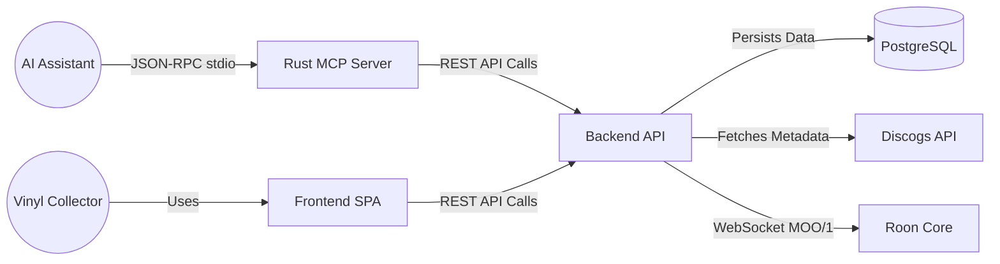

# Arc42 Architecture Documentation: Vinyl Tracker (AntiGrafity)

This document describes the software architecture of the **Vinyl Tracker** (AntiGrafity) application. It follows the [Arc42 template](https://arc42.org/).

## 1. Introduction and Goals

The **Vinyl Tracker** is a personal web application designed for vinyl enthusiasts to catalog their record collection and track listening habits.

### 1.1 Requirements Overview
- **Catalog Management**: Users can scan barcodes on vinyl records to automatically retrieve metadata (via the Discogs API) and add them to their personal collection.
- **Listening History**: Users can log when they listen to a record, creating a history of their listening habits.
- **Listening History Maintenance**: Users can explicitly delete individual listen events or reset their complete listening history from the Settings area.
- **Analytics**: Users can view statistics about their most played records and listening trends over time.
- **Collection Insights**: Dashboard provides Discogs collection value estimation and genre distribution from live analytics endpoints.
- **Multi-User**: Supports multiple users, each with their own collection and Discogs integration.
- **Barcode & QR Scanning**: Supports both mobile/desktop camera scanning (`html5-qrcode`) and hands-free handheld hardware scanners (e.g. Eyoyo EY-009P via global HID keyboard wedge listener in `ScannerService`) with configurable modes (Hardware, Camera, Hybrid) and live diagnostic testing.
- **QR Code Generation & Batch Export**: Ability to export the entire collection as a printable PDF from Settings, or selectively export marked records from the Collection view with quick selection reset.

### 1.2 Quality Goals
- **Maintainability**: High test coverage (>80%) and modular code structure.
- **Usability**: Responsive, modern, and aesthetically pleasing UI with intuitive interactions (glassmorphism, micro-animations, informative empty states).
- **Privacy**: Self-hosted solution where user data remains under their control; Discogs tokens are encrypted.
- **Reliability**: Robust handling of external API failures (Discogs) and database integrity.

### 1.3 Stakeholders
- **Users**: Vinyl collectors who want to organize their collection and see listening stats.
- **Developers**: Contributors maintaining and extending the open-source project.

## 2. Architecture Constraints

- **Technology Stack**:
    - **Backend**: Rust 2024 (Axum 0.8, Tokio, Tower-HTTP, SQLx 0.8). The former Spring Boot backend was replaced ([ADR-0001](adr/0001-backend-migration-spring-boot-zu-rust-axum.md)).
    - **Frontend**: Angular 22 (TypeScript, Signals, Tailwind CSS).
    - **MCP Server**: Rust (`rmcp` v3.5 SDK, stdio JSON-RPC).
    - **Database**: PostgreSQL 16.
    - **Caching & Rate Limiting**: `moka` (in-memory caches), `governor` (Discogs client and auth endpoints).
    - **Migrations**: `sqlx::migrate` (`backend/migrations/<n>_<name>.sql`, embedded at compile time, history in `_sqlx_migrations`). Existing refinery/Flyway histories are imported once on first start ([ADR-0017](adr/0017-datenbank-migrationen-mit-sqlx-migrate.md)).
    - **API Errors**: RFC 7807 Problem Details (`AppError` → `ProblemDetail`). No OpenAPI/Swagger endpoint.
    - **Containerization**: Docker & Docker Compose (`cargo-chef` multi-stage build).
- **License**: MIT License (Open Source).
- **Deployment**: Self-hosted via Docker Compose.
- **Browser Constraints**: Requires HTTPS (or localhost) for webcam access (Barcode scanning).

## 3. System Scope and Context

### 3.1 Business Context
The system acts as a personal catalog and usage tracker.
- **User**: Interacts with the Frontend via Browser/Mobile.
- **AI Assistant**: Interacts with the system via the native Rust Model Context Protocol (MCP) Server.
- **Discogs API**: External system used to fetch metadata (Artist, Title, Year, Cover Art) based on barcodes or search queries.
- **Roon Core**: Local music server (WebSocket over `ws://<ip>:9330/api` using binary MOO/1 protocol) used for direct zone selection and album playback ('Play Now').

**Context Diagram**:

### 3.2 Technical Context
- **Protocol**: HTTP/HTTPS (REST), WebSocket (MOO/1 protocol for Roon Core).
- **Format**: JSON, PDF (for exports).
- **Security**: JWT-based authentication with backend-managed HttpOnly cookies as primary mechanism and Bearer header fallback for constrained environments; BCrypt password hashing and AES-256-GCM encryption for Discogs API tokens.

## 4. Solution Strategy

- **Micro-Architecture**: Separation of Frontend (SPA) and Backend (REST API) to allow independent scaling and technology evolution.
- **Container-First**: The entire application is packaged as Docker containers to ensure consistent environments from development to production.
- **External Integration**: Rely on Discogs for rich metadata instead of building a proprietary database.
- **Resilience Strategy**: A `governor` rate limiter keeps the Discogs client within the API limit (60 requests per minute); server-side request timeouts (30 s / 300 s for long-running Discogs operations) bound hanging upstream calls. There are no automatic retries.
- **Caching Strategy**: `moka` in-memory caches for Discogs release details (24 h), price suggestions (1 h) and proxied cover images (24 h); prices and formats are additionally persisted in `record_cache`.
- **Testing**: rigorous automated testing (Unit & Integration) enforced by CI pipelines.

## 5. Building Block View

### 5.1 Level 1: Whitebox Overview

The system consists of three main containers:

| Building Block | Description | Technology |
| :--- | :--- | :--- |
| **Frontend** | Single Page Application handling UI, routing, and device integration (Camera & HID Scanner). | Angular 22, Tailwind CSS, html5-qrcode, ScannerService (HID listener) |
| **Backend** | Core business logic, API endpoints, schedulers, and database interactions. | Rust 2024, Axum 0.8, Tokio, SQLx |
| **API Types** (`vinyl-api-types`) | Request/response DTOs of the REST API, shared by Backend (serialization) and MCP Server (deserialization); JSON field names are pinned by contract tests. Workspace member of the backend at `backend/crates/vinyl-api-types`. | Rust, serde |
| **MCP Server** | Exposes collection, scanning, analytics and Roon actions as MCP tools/resources for AI assistants; calls the Backend REST API. | Rust, `rmcp`, `reqwest`, `vinyl-api-types` |
| **Database** | Persistent storage for users, records, and listening events. | PostgreSQL 16, `sqlx::migrate` |

### 5.2 Level 2: Backend Internals

The backend (`backend/src/`) follows a strict layered architecture (see `.agent/rules/coding_standards.md`):

- **Routes** (`routes/`): Axum routers and handlers per area – `users`, `collection`, `records`, `scan`, `analytics`, `discogs`, `print`, `storage`, `roon`, `proxy`, `actuator` (health/info). Handlers parse requests, resolve the user via the `CurrentUser` extractor and delegate to services. Cross-cutting layers: CORS, `TraceLayer`, request timeouts (`routes/timeout.rs`) and the per-IP auth rate limit.
- **Services** (`services/`): Business logic and data access with SQLx queries (no separate repository layer) – `user_service`, `collection_query`, `collection_sync`, `record_service`, `scan_service`, `analytics_service`, `marketplace` (condition-based pricing), `export_service` (CSV/JSON/PDF), `collection_restore` (merging JSON backup restore in one transaction), `print/` (print module: template renderers for Avery labels, scan list, QR cards and the inventory list via `printpdf`, `fast_qr`), `storage/` (shelf storage: storage types and shelves, even distribution, insertion by stored compartment boundaries and balancing of full compartments – ADR-0020), `image_proxy` (SSRF-protected), `crypto_service` (AES-256-GCM), `roon/` (SOOD discovery, WebSocket MOO/1 client, pairing, browse-and-play).
- **Clients** (`clients/discogs.rs`): `reqwest`-based Discogs API client with `governor` rate limiting and `moka` caches.
- **Models** (`models/`): Domain types (e.g. `AppUser` with `sqlx::FromRow`) and backend-internal DTOs. REST request/response DTOs shared with the MCP server live in the workspace crate `vinyl-api-types` and are re-exported here.
- **Infrastructure**: `auth/` (JWT, `CurrentUser` extractor, client IP resolution), `db/` (connection pool with startup retries, `sqlx::migrate` migrations), `config.rs` (environment configuration), `state.rs` (`AppState` shared by all handlers), `error.rs` (`AppError` → RFC 7807 `ProblemDetail`).
- **Persistence model**: Tables `app_user`, `record_cache` (+ `record_genres`, incl. `disc_count`), `collection_item` (user ↔ record incl. media/sleeve condition) and `listen_event`. Play counts and "last played" timestamps are computed from `listen_event`. Shelf storage (migration `10`): `storage_type` (grid, capacity per compartment, medium), `storage_unit` (shelf, order per medium) and `storage_boundary` (shelf sort key of the first record per compartment); the slot of every copy is computed from these boundaries, not stored. The JSON backup (`format_version: 3`) carries types, shelves and boundaries (`storage/backup.rs`).

## 6. Runtime View

### 6.1 Scenario: Scanning a Record
1.  **User** opens the scanner on the Frontend.
2.  **Frontend** accesses the camera and decodes a barcode.
3.  **Frontend** sends the barcode to `POST /api/scan`.
4.  **Backend** checks if the user has a linked Discogs account.
5.  **Backend** decrypts the user's Discogs token.
6.  **Backend** calls the **Discogs API** with the barcode.
7.  **Discogs API** returns release data.
8.  **Backend** returns the metadata to the Frontend.
9.  **User** confirms adding the record.
10. **Backend** saves the `Record` to the Database.

### 6.2 Scenario: Listening to a Record
1.  **User** selects a record from their collection.
2.  **User** clicks "Play".
3.  **Backend** receives `POST /api/records/{id}/listen`.
4.  **Backend** inserts a new row into `listen_event` with the current UTC timestamp.
5.  Play count and last-played time are derived from `listen_event` on the next read; no counters are stored on the record.

### 6.3 Scenario: Printing Labels and Lists
1.  **User** clicks "Drucken" in Settings (whole collection) or in the Collection toolbar (selection or current filters).
2.  **Frontend** opens the print dialog: template (Avery labels 70×37, scan list, QR cards, inventory list), scope and, for labels, the first free label on the sheet. The filter scope includes the location filter (`storage_unit`, `compartment`).
3.  **Frontend** posts `{ template, scope, options }` to `POST /api/print`.
4.  **Backend** `print` module validates the request and loads the records of the scope from the user's collection (one entry per copy, sorted by artist unless the filter sorts otherwise).
5.  **Backend** renders the PDF with the template's renderer (QR payload `discogs-id:<id>`). The inventory list groups the copies by their computed location (`StorageService::positions`): compartments in shelf order, copies without a place last.
6.  **Frontend** downloads `vinyl_<template>.pdf`.

### 6.4 Scenario: Resetting All Listening Events
1.  **User** opens the Settings page.
2.  **User** clicks "Reset All Listens" in the Data Management section.
3.  **Frontend** presents a confirmation dialog because the action is destructive and irreversible.
4.  **Frontend** sends `DELETE /api/scan/all` for the authenticated user after confirmation.
5.  **Backend** resolves the authenticated user via the `CurrentUser` extractor.
6.  **`scan_service`** deletes all `listen_event` rows belonging to that user in a single SQL statement.
7.  **Backend** returns a typed JSON response (`ResetResultDto`) containing success state, message, and deleted event count.
8.  **Frontend** displays the result as a success or failure toast message.

### 6.5 Scenario: Hardware Barcode Scanning (Eyoyo EY-009P / HID)
1.  **User** pairs the Eyoyo EY-009P via Bluetooth or 2.4 GHz USB receiver and selects *Hardware Scanner* mode in Settings.
2.  **User** aims the scanner at a vinyl sleeve or QR code and pulls the trigger (no input field focus required).
3.  **Frontend** `ScannerService` listens globally on `window` for rapid keystrokes (< 50ms) terminating with `Enter`.
4.  **ScannerService** filters out normal typing, plays an optional audio beep, and identifies the payload (1D Barcode vs 2D QR Code).
5.  **Frontend** automatically routes the decoded barcode to `POST /api/scan` and logs the listening session or opens the Discogs match preview.

### 6.6 Scenario: Batch Printing Selected Records
1.  **User** navigates to the Collection table view.
2.  **User** checks the selection checkboxes in column 1 for specific albums to print.
3.  **Frontend** updates the selection count and displays the "Drucken (N)" and "Auswahl aufheben" buttons in the toolbar.
4.  **User** clicks "Drucken (N)" and confirms the print dialog with scope "Auswahl".
5.  **Frontend** posts the selected Discogs IDs to `POST /api/print` (`scope.type = "ids"`).
6.  **Backend** prints only those records of the user's collection; foreign IDs are ignored.
7.  **Frontend** prompts a file download.

### 6.7 Scenario: Editing Media & Sleeve Condition with Discogs Sync
1.  **User** opens the record detail modal for an album in their collection.
2.  **User** selects a Goldmine grading (e.g. *Mint (M)*, *Near Mint (NM or M-)*, *Very Good Plus (VG+)*) from the Media Condition or Sleeve Condition dropdown.
3.  **Frontend** sends `PATCH /api/records/{id}/condition` with the selected values.
4.  **Backend** `record_service` persists the updated condition in the `collection_item` table.
5.  If Media Condition changed, **`record_service`** recalculates the estimated market price from Discogs price suggestions and updates `record_cache.median_price`.
6.  **Backend** `DiscogsClient` (`clients/discogs.rs`) synchronizes the custom fields to the user's Discogs collection instance (`POST /users/{username}/collection/folders/0/releases/{release_id}/instances/{instance_id}/fields/{field_id}`).
7.  **Backend** returns the updated `RecordDetailDto`.
8.  **Frontend** updates the modal, live condition badges, estimated value, and collection view reactively.

### 6.8 Scenario: Adding a Record to the Shelves
1.  **User** adds a record via scan or search (`POST /api/collection/releases/{id}`).
2.  **Backend** `collection_sync` adds it to Discogs and the local collection, then calls `StorageService::place_new_copy`.
3.  **`storage`** loads the copies of the record's medium and the stored compartment boundaries, computes the layout without and with the new copy (assignment by boundaries, then balancing of overflowing compartments towards the nearest compartment with space) and stores the new boundaries.
4.  **Backend** returns the placement hint in the `SyncResult`: shelf, compartment (row/column), neighbors and the copies that move to another compartment.
5.  **Frontend** shows the hint below the success message. Discogs syncs and backup restores sort in new copies the same way (`StorageService::commit_all`).

## 7. Deployment View

The system is deployed as a multi-container Docker application orchestrated by Docker Compose.

- **Host**: Any machine running Docker (Linux Server, Raspberry Pi, macOS).
- **Network**: Private Docker network `default`.
- **Volumes**: `postgres_data` for database persistence.
- **Configuration**: Environment variables via `.env` file.

**Docker Compose Structure**:
- `postgres`: Database service containing the `vinyl_tracker` data. Includes a robust `pg_isready` healthcheck.
- `backend`: Rust/Axum binary (minimal Debian image), depends on `postgres` being `service_healthy`; runs migrations on startup and shuts down gracefully on `SIGTERM`. Port 8080 (production compose: bound to `127.0.0.1` only).
- `frontend`: Nginx (Production, port 80, proxies `/api` to the backend) or Angular dev-server (Development, port 5173). Serves the built Angular PWA.

## 8. Cross-cutting Concepts

### 8.1 Security
- **Authentication**: JWT-based authentication. Backend issues and verifies an HttpOnly auth cookie for normal request flows; frontend additionally supports `Authorization: Bearer` fallback when cookie propagation is not available.
- **Rate Limiting & Brute-Force Protection**: Public authentication endpoints (`/api/users/login`, `/api/users/register`, `/api/users/reset-password`) are protected by a keyed `governor` rate limiter (`auth_rate_limit_middleware`). Limits are enforced per client IP (configurable via `AUTH_RATE_LIMIT_FOR_PERIOD`, default 10 requests/minute). The client IP is the TCP peer; `X-Forwarded-For` / `X-Real-IP` are only honoured from `TRUSTED_PROXIES` ([ADR-0016](adr/0016-vertrauenswuerdige-proxies-fuer-client-ip-ermittlung.md)). Requests exceeding the limit receive HTTP 429 as RFC-7807 `ProblemDetail`.
- **Data Protection**:
    - User passwords are hashed with **BCrypt** (`bcrypt` crate; the salt is embedded in the hash, the former `salt` column was dropped in migration `5`).
    - Discogs tokens are encrypted with **AES-256-GCM** (key derived via PBKDF2-HMAC-SHA256 from `VINYL_ENCRYPTION_PASSWORD`/`VINYL_ENCRYPTION_SALT`); legacy AES-CBC values from the Java era are still decrypted ([ADR-0004](adr/0004-aead-aes-256-gcm-kryptografie-fuer-tokens.md)).
- **Network Exposure**: In the production compose files backend (8080) and PostgreSQL (5432) are only bound to `127.0.0.1`; external access goes through nginx.
- **Supply Chain**: GitHub Actions are pinned to commit SHAs and updated by Dependabot; fork PR workflows require maintainer approval.

### 8.2 Validation
- Request bodies are deserialized into typed DTOs (Serde); malformed JSON is rejected by Axum before reaching a handler. Business validation happens explicitly in the services and returns `AppError::BadRequest` (HTTP 400).
- **Password Policy**: User passwords must be at least 8 characters long, enforced in `user_service` (register, reset) and in the frontend forms.
- Destructive user actions in the UI require an explicit confirmation step before the backend request is issued.

### 8.3 Error Handling
- All handlers return `Result<_, AppError>`. `AppError` (`backend/src/error.rs`) maps to RFC-7807 `ProblemDetail` JSON (`type`, `title`, `status`, `detail`, optional `instance`):
    - `BadRequest` → 400, `Unauthorized` → 401, `Forbidden` → 403, `NotFound` → 404, `Conflict` → 409, `TooManyRequests` → 429
    - `Timeout` → 503 (request exceeded `REQUEST_TIMEOUT_SECS` / `LONG_REQUEST_TIMEOUT_SECS`)
    - `Database`, `Migration`, `Config`, `Internal` → 500 (details are logged; database errors are not exposed to the client)
- Failures of external integrations (Discogs, Roon) are currently reported as `Internal` (HTTP 500) with a descriptive message.
- Unknown routes return a 404 `ProblemDetail` via the router fallback.
- Lightweight success responses (e.g. scan, reset) are typed DTOs instead of ad-hoc maps.

### 8.4 Observability & Logging
- **Backend Logging**: Structured text logs via `tracing` (filter `RUST_LOG`); `tower_http::TraceLayer` logs every HTTP request with status and latency, `AppError` logs server-side failures.
- **Frontend Logging**: 
    - **Browser Environment**: An Angular `HttpInterceptorFn` (`authInterceptor`) logs request latencies and response statuses transparently into the browser console.
    - **Container Proxy**: The frontend Docker container (Nginx in production, Angular dev-server in development) intercepts proxy API traffic and logs metrics matching the backend console format for centralized Docker monitoring.

### 8.5 API Documentation
- The REST API has no OpenAPI/Swagger endpoint. The contract is defined by the Rust DTOs in `backend/crates/vinyl-api-types` (pinned by JSON contract tests) and the backend-internal models; the MCP server uses the same crate.

### 8.6 Delivery Workflow
- **Branch Strategy**: The project uses a simplified flow with two main branches: `develop` (for new features) and `main` (for stable releases). Development happens in temporary feature branches that are merged into `develop`.
- **Versioning**: Before merging into `main`, version bumps across the frontend, backend, and documentation are automated via the `./scripts/release.sh` script on the `develop` branch.
- **Continuous Deployment (CD)**: Merging `develop` into `main` triggers the CI pipeline on `main`, which (after all tests) builds multi-arch frontend and backend Docker images, tags them `latest` and `v<version>` (from `frontend/package.json`) and pushes them to GHCR. In parallel, `release.yml` creates the GitHub Release `v<version>` with generated notes and attaches native MCP server binaries (Linux, macOS).

## 9. Architecture Decisions

Architectural decisions in Vinyl Tracker are maintained as formal **Architecture Decision Records (ADRs)** located in [`docs/adr/`](adr/README.md).

| ADR | Date | Title | Status |
| :--- | :--- | :--- | :--- |
| [ADR-0001](adr/0001-backend-migration-spring-boot-zu-rust-axum.md) | 2026-10-05 | Migration of backend from Spring Boot (Java) to Rust (Axum, SQLx, Tokio) | `Accepted` |
| [ADR-0002](adr/0002-frontend-upgrade-auf-angular-22-und-signals.md) | 2026-10-18 | Frontend upgrade to Angular 22, Signals, and Vite-based Application Builder | `Accepted` |
| [ADR-0003](adr/0003-nativer-rust-mcp-server-mit-rmcp.md) | 2026-10-17 | Native Rust Model Context Protocol (MCP) server with `rmcp` SDK | `Accepted` |
| [ADR-0004](adr/0004-aead-aes-256-gcm-kryptografie-fuer-tokens.md) | 2026-10-17 | Cryptographic modernization to authenticated AES-256-GCM (AEAD) for Discogs tokens | `Accepted` |
| [ADR-0005](adr/0005-direkte-roon-core-integration-via-websocket-moo.md) | 2026-10-17 | Direct Roon Core integration via WebSockets and binary MOO/1 protocol | `Accepted` |
| [ADR-0006](adr/0006-rust-test-coverage-enforcement-mit-cargo-llvm-cov.md) | 2026-10-18 | Automated Rust test coverage enforcement in CI pipeline via `cargo-llvm-cov` (>= 80%) | `Accepted` |
| [ADR-0007](adr/0007-hardware-scanner-integration-ueber-keyboard-wedge.md) | 2026-10-12 | Eyoyo EY-009P & hardware scanner integration via global HID keyboard wedge listener | `Accepted` |
| [ADR-0008](adr/0008-zustandsbasierte-marktwert-ermittlung-nach-goldmine-standard.md) | 2026-10-14 | Condition-based market valuation and caching following Goldmine standard | `Accepted` |
| [ADR-0009](adr/0009-natuerliche-kuenstlersortierung-mit-kallax-collation.md) | 2026-10-18 | Natural artist sorting with article normalization and Kallax shelving collation | `Accepted` |
| [ADR-0010](adr/0010-serverseitige-vektor-pdf-generierung-via-printpdf.md) | 2026-10-15 | Server-side vector PDF generation via `printpdf` and `fast_qr` instead of headless browser | `Accepted` |
| [ADR-0011](adr/0011-dreiteilige-sammlungs-export-und-backup-strategie.md) | 2026-10-18 | Three-tier collection export and backup strategy (CSV, JSON, PDF) | `Accepted` |
| [ADR-0012](adr/0012-ssrf-geschuetzter-image-proxy-fuer-album-cover.md) | 2026-10-15 | Image proxy with Server-Side Request Forgery (SSRF) protection for album covers | `Accepted` |
| [ADR-0013](adr/0013-multi-architektur-container-builds-via-cargo-chef-und-buildplatform.md) | 2026-10-15 | Multi-architecture container builds via native compilation (`$BUILDPLATFORM`) and `cargo-chef` | `Accepted` |
| [ADR-0014](adr/0014-spec-driven-development-mit-openspec.md) | 2026-10-19 | Spec-Driven Development (SDD) with OpenSpec and native Antigravity integration | `Accepted` |
| [ADR-0015](adr/0015-automatisierte-ci-pipeline-ueberwachung-und-self-healing-agent.md) | 2026-10-19 | Automated CI pipeline monitoring and self-healing agent with GitHub CLI | `Accepted` |
| [ADR-0016](adr/0016-vertrauenswuerdige-proxies-fuer-client-ip-ermittlung.md) | 2026-10-19 | Trusted proxies for client IP resolution (auth rate limiting) | `Accepted` |
| [ADR-0017](adr/0017-datenbank-migrationen-mit-sqlx-migrate.md) | 2026-10-19 | Database migrations with `sqlx::migrate` instead of `refinery` | `Accepted` |
| [ADR-0018](adr/0018-frontend-unit-tests-mit-vitest.md) | 2026-10-19 | Frontend unit tests with Vitest instead of Karma/Jasmine | `Accepted` |
| [ADR-0019](adr/0019-druck-modul-mit-vorlagen-renderern.md) | 2026-10-20 | Print module with template renderers (`POST /api/print`) | `Accepted` |
| [ADR-0020](adr/0020-lagerposition-aus-gespeicherten-fachgrenzen.md) | 2026-10-20 | Shelf position computed from stored compartment boundaries | `Accepted` |

## 10. Quality Requirements

- **Test Coverage**: Strict requirement of >=80% line coverage for both Backend (`cargo llvm-cov --fail-under-lines 80`) and Frontend (Vitest via `@angular/build:unit-test`, thresholds for statements/branches/functions/lines in `angular.json`). Both are enforced in the CI pipeline.
- **End-to-End Testing**: Automated Playwright E2E test suite covering authentication, navigation, dashboard scanner access, and Discogs sync flows, executed on every PR/push in the CI pipeline.
- **Dependency Hygiene**: Dependabot proposes weekly updates for GitHub Actions; npm installs run without `--legacy-peer-deps` so peer conflicts surface. (No automated vulnerability audit for Rust crates yet.)
- **Static Checks**: `cargo fmt --all -- --check` and `cargo clippy --all-targets -- -D warnings` for backend and MCP server; TypeScript strict build for the frontend.
- **Responsiveness**: The UI must adapt to mobile screens (< 768px) for usable barcode scanning on phones.
- **Performance**: API responses should be < 200ms (excluding external Discogs calls). Heavily accessed relationships (e.g. `user_id` on collections and listen events, `discogs_id` on records) are backed by explicit B-tree indexes (migration `2`). Collection listing, filtering and sorting run as SQL queries in `collection_query` instead of per-row lookups. Release pricing (`lowest_price`, `median_price`) and media format (`format`) are persisted in `record_cache` (migrations `3`, `4`, `9`) to avoid repeated remote marketplace lookups.

## 11. Risks and Technical Debt

- **Discogs Dependency**: The core scanning feature relies heavily on the Discogs API availability and rate limits.
    - *Mitigation*: Rate limiting and `moka` caches reduce API calls; a manual entry fallback is a possible future feature.
- **HTTPS Requirement**: Barcode scanning requires a secure context (HTTPS/localhost).
    - *Mitigation*: `mkcert` workflow documented for local development. Production setup requires a reverse proxy with SSL (e.g., Traefik/Nginx).

## 12. Glossary

- **PWA**: Progressive Web App (web apps that behave like native apps).
- **SPA**: Single Page Application (Frontend architecture).
- **Discogs**: Third-party database for music releases.
- **Barcode**: UPC/EAN code on the back of vinyl records.
