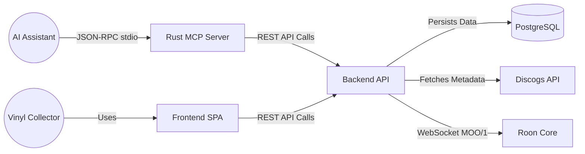

# Arc42 Architecture Documentation: Vinyl Tracker (AntiGrafity)

This document describes the software architecture of the **Vinyl Tracker** (AntiGrafity) application. It follows the [Arc42 template](https://arc42.org/).

## 1. Introduction and Goals

The **Vinyl Tracker** is a personal web application designed for vinyl enthusiasts to catalog their record collection and track listening habits.

### 1.1 Requirements Overview
- **Catalog Management**: Users can scan barcodes on vinyl records to automatically retrieve metadata (via the Discogs API) and add them to their personal collection.
- **Listening History**: Users can log when they listen to a record, creating a history of their listening habits.
- **Listening History Maintenance**: Users can explicitly delete individual listen events or reset their complete listening history from the Settings area.
- **Analytics**: Users can view statistics about their most played records and listening trends over time.
- **Collection Insights**: Dashboard provides Discogs collection value estimation and genre distribution from live analytics endpoints.
- **Multi-User**: Supports multiple users, each with their own collection and Discogs integration.
- **Barcode & QR Scanning**: Supports both mobile/desktop camera scanning (`html5-qrcode`) and hands-free handheld hardware scanners (e.g. Eyoyo EY-009P via global HID keyboard wedge listener in `ScannerService`) with configurable modes (Hardware, Camera, Hybrid) and live diagnostic testing.
- **QR Code Generation & Batch Export**: Ability to export the entire collection as a printable PDF from Settings, or selectively export marked records from the Collection view with quick selection reset.

### 1.2 Quality Goals
- **Maintainability**: High test coverage (>80%) and modular code structure.
- **Usability**: Responsive, modern, and aesthetically pleasing UI with intuitive interactions (glassmorphism, micro-animations, informative empty states).
- **Privacy**: Self-hosted solution where user data remains under their control; Discogs tokens are encrypted.
- **Reliability**: Robust handling of external API failures (Discogs) and database integrity.

### 1.3 Stakeholders
- **Users**: Vinyl collectors who want to organize their collection and see listening stats.
- **Developers**: Contributors maintaining and extending the open-source project.

## 2. Architecture Constraints

- **Technology Stack**:
    - **Primary Backend**: Rust (Axum 0.8, Tokio, Tower-HTTP, SQLx).
    - **Legacy Backend**: Java 25+ (Spring Boot 4.0+).
    - **Frontend**: Angular 22 (TypeScript, Signals, Tailwind CSS).
    - **MCP Server**: Rust (`rmcp` v3.5 SDK, stdio JSON-RPC).
    - **Database**: PostgreSQL 16.
    - **Caching & Resilience**: `moka`, `governor` (Rust); Caffeine, Resilience4j (Java legacy).
    - **Migrations**: `refinery` (Rust, Flyway-compatible) & Flyway (Java legacy).
    - **API Documentation**: RFC 7807 Problem Details; springdoc-openapi (Swagger UI on legacy).
    - **Containerization**: Docker & Docker Compose (`cargo-chef` multi-stage build).
- **License**: MIT License (Open Source).
- **Deployment**: Self-hosted via Docker Compose.
- **Browser Constraints**: Requires HTTPS (or localhost) for webcam access (Barcode scanning).

## 3. System Scope and Context

### 3.1 Business Context
The system acts as a personal catalog and usage tracker.
- **User**: Interacts with the Frontend via Browser/Mobile.
- **AI Assistant**: Interacts with the system via the native Rust Model Context Protocol (MCP) Server.
- **Discogs API**: External system used to fetch metadata (Artist, Title, Year, Cover Art) based on barcodes or search queries.
- **Roon Core**: Local music server (WebSocket over `ws://<ip>:9330/api` using binary MOO/1 protocol) used for direct zone selection and album playback ('Play Now').

**Context Diagram**:

### 3.2 Technical Context
- **Protocol**: HTTP/HTTPS (REST), WebSocket (MOO/1 protocol for Roon Core).
- **Format**: JSON, PDF (for exports).
- **Security**: JWT-based authentication with backend-managed HttpOnly cookies as primary mechanism and Bearer header fallback for constrained environments; BCrypt password hashing and AES encryption for Discogs API tokens.

## 4. Solution Strategy

- **Micro-Architecture**: Separation of Frontend (SPA) and Backend (REST API) to allow independent scaling and technology evolution.
- **Container-First**: The entire application is packaged as Docker containers to ensure consistent environments from development to production.
- **External Integration**: Rely on Discogs for rich metadata instead of building a proprietary database.
- **Resilience Strategy**: Use Resilience4j to strictly adhere to Discogs API rate limits (60 requests per minute) and handle transient network issues via smart retries.
- **Caching Strategy**: Implement Caffeine-based local caching for frequently accessed, static metadata (e.g., release details) to reduce external API dependency and improve latency.
- **Testing**: rigorous automated testing (Unit & Integration) enforced by CI pipelines.

## 5. Building Block View

### 5.1 Level 1: Whitebox Overview

The system consists of three main containers:

| Building Block | Description | Technology |
| :--- | :--- | :--- |
| **Frontend** | Single Page Application handling UI, routing, and device integration (Camera & HID Scanner). | Angular 22, Tailwind CSS, html5-qrcode, ScannerService (HID listener) |
| **Backend** | Core business logic, API endpoints, schedulers, and database interactions. | Java 25, Spring Boot, Spring Data JPA, Lombok |
| **Database** | Persistent storage for users, records, and listening events. | PostgreSQL 16, Flyway |

### 5.2 Level 2: Backend Internals

The Backend follows a layered architecture:

- **Controller Layer**: Handles HTTP requests (`ScanController`, `AppUserController`, `AnalyticsController`, `CollectionController`, `RecordController`, `DiscogsController`, `RoonController`).
- **Service Layer**: Business logic and orchestration (`ScanService`, `DiscogsApiClient`, `CollectionQueryService`, `CollectionSyncService`, `TokenEncryptionService`, `QrCodeService`, `PdfService`, `RecordService`, `DiscogsService`, `RoonApiService`, `DefaultRoonClient`). `ScanService` is responsible for both creating listen events and bulk-deleting all listen events for the authenticated user. `RoonApiService` coordinates WebSocket MOO/1 protocol connections to Roon Core, extension pairing, and browse-and-play actions.
- **Repository Layer**: Data access interface (`RecordRepository`, `ListenEventRepository`, `AppUserRepository`, `CollectionItemRepository`). `ListenEventRepository` provides user-scoped queries for recent history, analytics aggregation, and bulk deletion.
- **Model Layer**: Domain entities (`AppUser`, `Record`, `ListenEvent`). `AppUser` includes configured Roon host, port, default playback zone, and paired token.
- **DTO Layer**: Request/response payloads are modeled with explicit DTO classes instead of generic maps. Example: scan responses use `ScanDto.Result`, and Roon operations use `RoonSettingsDto`, `RoonStatusDto`, `RoonZoneDto`, and `RoonPlayRequestDto`.

## 6. Runtime View

### 6.1 Scenario: Scanning a Record
1.  **User** opens the scanner on the Frontend.
2.  **Frontend** accesses the camera and decodes a barcode.
3.  **Frontend** sends the barcode to `POST /api/scan`.
4.  **Backend** checks if the user has a linked Discogs account.
5.  **Backend** decrypts the user's Discogs token.
6.  **Backend** calls the **Discogs API** with the barcode.
7.  **Discogs API** returns release data.
8.  **Backend** returns the metadata to the Frontend.
9.  **User** confirms adding the record.
10. **Backend** saves the `Record` to the Database.

### 6.2 Scenario: Listening to a Record
1.  **User** selects a record from their collection.
2.  **User** clicks "Play".
3.  **Backend** receives `POST /api/records/{id}/listen`.
4.  **Backend** creates a new `ListenEvent` with the current timestamp.
5.  **Backend** updates the `playCount` and `lastPlayed` fields on the `Record`.

### 6.3 Scenario: Generating QR Codes
1.  **User** clicks "Download QR Codes PDF" in Settings.
2.  **Frontend** requests `GET /api/collection/qr-codes/all`.
3.  **Backend** fetches User's releases from Discogs.
4.  **Backend** sorts releases by Artist.
5.  **Backend** generates QR codes for each release.
6.  **Backend** compiles a PDF grid.
7.  **Backend** returns the PDF binary.
8.  **Frontend** triggers a file download.

### 6.4 Scenario: Resetting All Listening Events
1.  **User** opens the Settings page.
2.  **User** clicks "Reset All Listens" in the Data Management section.
3.  **Frontend** presents a confirmation dialog because the action is destructive and irreversible.
4.  **Frontend** sends `DELETE /api/scan/all` for the authenticated user after confirmation.
5.  **Backend** resolves the authenticated user from the security context.
6.  **ScanService** loads the user entity and delegates the deletion to `ListenEventRepository`.
7.  **ListenEventRepository** deletes all `ListenEvent` rows belonging to that user in a single bulk operation.
8.  **Backend** returns a typed JSON response containing success state, message, and deleted event count.
9.  **Frontend** displays the result as a success or failure toast message.

### 6.5 Scenario: Hardware Barcode Scanning (Eyoyo EY-009P / HID)
1.  **User** pairs the Eyoyo EY-009P via Bluetooth or 2.4 GHz USB receiver and selects *Hardware Scanner* mode in Settings.
2.  **User** aims the scanner at a vinyl sleeve or QR code and pulls the trigger (no input field focus required).
3.  **Frontend** `ScannerService` listens globally on `window` for rapid keystrokes (< 50ms) terminating with `Enter`.
4.  **ScannerService** filters out normal typing, plays an optional audio beep, and identifies the payload (1D Barcode vs 2D QR Code).
5.  **Frontend** automatically routes the decoded barcode to `POST /api/scan` and logs the listening session or opens the Discogs match preview.

### 6.6 Scenario: Batch Printing Selected QR Codes
1.  **User** navigates to the Collection table view.
2.  **User** checks the selection checkboxes in column 1 for specific albums to print.
3.  **Frontend** updates the selection count and displays the "Drucken (N)" and "Auswahl aufheben" buttons in the toolbar.
4.  **User** clicks "Drucken (N)".
5.  **Frontend** posts selected item metadata to `POST /api/collection/qr-codes/selected`.
6.  **Backend** `PdfService` generates a tailored PDF document for only the selected releases.
7.  **Frontend** streams the binary blob and prompts a file download.

### 6.7 Scenario: Editing Media & Sleeve Condition with Discogs Sync
1.  **User** opens the record detail modal for an album in their collection.
2.  **User** selects a Goldmine grading (e.g. *Mint (M)*, *Near Mint (NM or M-)*, *Very Good Plus (VG+)*) from the Media Condition or Sleeve Condition dropdown.
3.  **Frontend** sends `PATCH /api/records/{id}/condition` with the selected values.
4.  **Backend** `RecordService` persists the updated condition in the `collection_item` table.
5.  If Media Condition changed, **RecordService** recalculates the estimated market price from Discogs price suggestions and updates `record_cache.median_price`.
6.  **Backend** `DiscogsApiClient` synchronizes the custom fields to the user's Discogs collection instance (`POST /users/{username}/collection/folders/0/releases/{release_id}/instances/{instance_id}/fields/{field_id}`).
7.  **Backend** returns the updated `RecordDetailDto`.
8.  **Frontend** updates the modal, live condition badges, estimated value, and collection view reactively.

## 7. Deployment View

The system is deployed as a multi-container Docker application orchestrated by Docker Compose.

- **Host**: Any machine running Docker (Linux Server, Raspberry Pi, macOS).
- **Network**: Private Docker network `default`.
- **Volumes**: `postgres_data` for database persistence.
- **Configuration**: Environment variables via `.env` file.

**Docker Compose Structure**:
- `postgres`: Database service containing the `vinyl_tracker` data. Includes a robust `pg_isready` healthcheck.
- `backend`: Java application, strictly depends on `postgres` being in a `service_healthy` state to prevent startup failures. Exposed on port 8080.
- `frontend`: Nginx (Production, port 80) or Angular dev-server (Development, port 5173). Serves the built Angular PWA.

## 8. Cross-cutting Concepts

### 8.1 Security
- **Authentication**: JWT-based authentication. Backend issues and verifies an HttpOnly auth cookie for normal request flows; frontend additionally supports `Authorization: Bearer` fallback when cookie propagation is not available.
- **Rate Limiting & Brute-Force Protection**: Public authentication endpoints (`/api/users/login`, `/api/users/register`, `/api/users/reset-password`) are protected against brute-force attacks via Resilience4j `RateLimiter` (`AuthRateLimitingInterceptor` & `AuthRateLimiterService`). Limits are enforced per client IP (configurable via `AUTH_RATE_LIMIT_FOR_PERIOD`, default 10 requests/minute). Requests exceeding the limit immediately receive HTTP 429 (`TOO_MANY_REQUESTS`) formatted as RFC-7807 `ProblemDetail`.
- **Data Protection**:
    - User passwords are hashed with **BCrypt** (which embeds a cryptographically secure random salt directly into the hash string; the redundant database `salt` column was removed in Flyway `V5`).
    - Sensitive external tokens (Discogs PAT) are encrypted using **AES-256** (via Spring Security Crypto) with a salt and key defined in environment variables.
- **Dependency Security**: The backend provides an opt-in Maven profile `security-online` that audits dependencies against the Sonatype OSS Index online service during `verify`.

### 8.2 Validation
- Input validation using Jakarta Validation API (`@Valid`, `@NotNull`, `@NotBlank`, `@NotEmpty`, `@Size`, etc.) across all controllers and DTOs, including QR code generation requests (`QrCodeRequest`).
- **Password Policy**: User passwords must be at least 8 characters long (up to 128), enforced in backend DTOs and frontend registration/reset forms.
- Destructive user actions in the UI require an explicit confirmation step before the backend request is issued.

### 8.3 Error Handling
- Global exception handling in Spring Boot (`@ControllerAdvice`) returns RFC-7807 style `ProblemDetail` JSON payloads (including title, detail, status and timestamp) for API errors.
- **Specific Integration Exceptions**: Replaced generic `RuntimeException` throws in the `DiscogsService` with a tailored hierarchy:
    - `DiscogsTokenException` (HTTP 422) for encryption and token-level issues.
    - `DiscogsApiException` (HTTP 502) for external API communication failures.
    - `RoonApiException` (HTTP 502) for Roon Core WebSocket and playback execution errors.
    - `CollectionSyncException` (HTTP 500) for batch synchronization errors.
    - `PdfGenerationException` (HTTP 500) for PDF and QR code compilation failures.
- Endpoint-specific failure paths in analytics endpoints are aligned to the same ProblemDetail structure.
- Lightweight success responses for scan-related endpoints are returned as typed DTOs instead of ad-hoc maps, improving schema clarity across backend and frontend.

### 8.4 Observability & Logging
- **Backend Logging**: A global `HandlerInterceptor` tracks HTTP request execution times, final status codes, and implicitly catches and logs thrown exceptions for all `/api/**` endpoints.
- **Frontend Logging**: 
    - **Browser Environment**: An Angular `HttpInterceptorFn` (`authInterceptor`) logs request latencies and response statuses transparently into the browser console.
    - **Container Proxy**: The frontend Docker container (Nginx in production, Angular dev-server in development) intercepts proxy API traffic and logs metrics matching the backend console format for centralized Docker monitoring.

### 8.5 API Documentation
- The backend exposes an OpenAPI 3 specification and interactive Swagger UI via `springdoc-openapi` (`/v3/api-docs` and `/swagger-ui.html`).
- These endpoints are permitted without authentication in `SecurityConfig`, but are **disabled in production** through the `SPRINGDOC_API_DOCS_ENABLED=false` and `SPRINGDOC_SWAGGER_UI_ENABLED=false` environment variables set in `docker/docker-compose.prod.yml`, so the schema is not exposed on public deployments.

### 8.6 Delivery Workflow
- **Branch Strategy**: The project uses a simplified flow with two main branches: `develop` (for new features) and `main` (for stable releases). Development happens in temporary feature branches that are merged into `develop`.
- **Versioning**: Before merging into `main`, version bumps across the frontend, backend, and documentation are automated via the `./scripts/release.sh` script on the `develop` branch.
- **Continuous Deployment (CD)**: Releases are managed via GitHub Releases. Creating a new GitHub Release (e.g. `v1.5.0`) pointing to `main` issues a Git Tag. The GitHub Actions CI pipeline listens to tags matching `v*.*.*`, runs backend tests and the `security-online` dependency audit, builds the frontend and backend Docker Images, tags them appropriately (`latest` and `v1.5.0`), and pushes them to the GitHub Container Registry (GHCR).

## 9. Architecture Decisions

Architectural decisions in Vinyl Tracker are maintained as formal **Architecture Decision Records (ADRs)** located in [`docs/adr/`](adr/README.md).

| ADR | Date | Title | Status |
| :--- | :--- | :--- | :--- |
| [ADR-0001](adr/0001-backend-migration-spring-boot-zu-rust-axum.md) | 2026-10-05 | Migration of backend from Spring Boot (Java) to Rust (Axum, SQLx, Tokio) | `Accepted` |
| [ADR-0002](adr/0002-frontend-upgrade-auf-angular-22-und-signals.md) | 2026-10-18 | Frontend upgrade to Angular 22, Signals, and Vite-based Application Builder | `Accepted` |
| [ADR-0003](adr/0003-nativer-rust-mcp-server-mit-rmcp.md) | 2026-10-17 | Native Rust Model Context Protocol (MCP) server with `rmcp` SDK | `Accepted` |
| [ADR-0004](adr/0004-aead-aes-256-gcm-kryptografie-fuer-tokens.md) | 2026-10-17 | Cryptographic modernization to authenticated AES-256-GCM (AEAD) for Discogs tokens | `Accepted` |
| [ADR-0005](adr/0005-direkte-roon-core-integration-via-websocket-moo.md) | 2026-10-17 | Direct Roon Core integration via WebSockets and binary MOO/1 protocol | `Accepted` |
| [ADR-0006](adr/0006-rust-test-coverage-enforcement-mit-cargo-llvm-cov.md) | 2026-10-18 | Automated Rust test coverage enforcement in CI pipeline via `cargo-llvm-cov` (>= 80%) | `Accepted` |
| [ADR-0007](adr/0007-hardware-scanner-integration-ueber-keyboard-wedge.md) | 2026-10-12 | Eyoyo EY-009P & hardware scanner integration via global HID keyboard wedge listener | `Accepted` |
| [ADR-0008](adr/0008-zustandsbasierte-marktwert-ermittlung-nach-goldmine-standard.md) | 2026-10-14 | Condition-based market valuation and caching following Goldmine standard | `Accepted` |
| [ADR-0009](adr/0009-natuerliche-kuenstlersortierung-mit-kallax-collation.md) | 2026-10-18 | Natural artist sorting with article normalization and Kallax shelving collation | `Accepted` |
| [ADR-0010](adr/0010-serverseitige-vektor-pdf-generierung-via-printpdf.md) | 2026-10-15 | Server-side vector PDF generation via `printpdf` and `fast_qr` instead of headless browser | `Accepted` |
| [ADR-0011](adr/0011-dreiteilige-sammlungs-export-und-backup-strategie.md) | 2026-10-18 | Three-tier collection export and backup strategy (CSV, JSON, PDF) | `Accepted` |
| [ADR-0012](adr/0012-ssrf-geschuetzter-image-proxy-fuer-album-cover.md) | 2026-10-15 | Image proxy with Server-Side Request Forgery (SSRF) protection for album covers | `Accepted` |
| [ADR-0013](adr/0013-multi-architektur-container-builds-via-cargo-chef-und-buildplatform.md) | 2026-10-15 | Multi-architecture container builds via native compilation (`$BUILDPLATFORM`) and `cargo-chef` | `Accepted` |
| [ADR-0014](adr/0014-spec-driven-development-mit-openspec.md) | 2026-10-19 | Spec-Driven Development (SDD) with OpenSpec and native Antigravity integration | `Accepted` |
| [ADR-0015](adr/0015-automatisierte-ci-pipeline-ueberwachung-und-self-healing-agent.md) | 2026-10-19 | Automated CI pipeline monitoring and self-healing agent with GitHub CLI | `Accepted` |
| [ADR-0016](adr/0016-vertrauenswuerdige-proxies-fuer-client-ip-ermittlung.md) | 2026-10-19 | Trusted proxies for client IP resolution (auth rate limiting) | `Accepted` |

## 10. Quality Requirements

- **Test Coverage**: Strict requirement of >80% line coverage for both Backend (JaCoCo) and Frontend (Karma/Jasmine). Enforced in CI/CD via `karma.conf.js` global threshold checks and JaCoCo maven verification.
- **End-to-End Testing**: Automated Playwright E2E test suite covering authentication, navigation, dashboard scanner access, and Discogs sync flows, executed on every PR/push in the CI pipeline.
- **Dependency Hygiene**: Backend dependencies are checked in CI against Sonatype OSS Index; findings are reported to an audit artifact (`ossindex-audit.json`) with the current configuration set to non-blocking (`fail=false`).
- **Test Execution Split**: Unit tests run via Surefire during `test`, while integration tests run via Failsafe during `verify`. This improves local feedback speed while keeping full validation in CI.
- **Responsiveness**: The UI must adapt to mobile screens (< 768px) for usable barcode scanning on phones.
- **Performance**: API responses should be < 200ms (excluding external Discogs calls). Heavily accessed database relationships (e.g. `user_id` on collections, `discogs_id` on records) are backed by explicit B-tree indexes applied via Flyway to prevent query degradation as dataset sizes grow. The `Record.genres` `@ElementCollection` is fetched `LAZY` with a Hibernate `@BatchSize(50)` to avoid per-row genre queries (N+1) when listing collections and computing analytics. Release pricing (`lowest_price`, `median_price`) and media format (`format`) are cached directly in the `record_cache` table via Flyway migrations `V3`, `V4`, and `V9` to avoid repeated remote marketplace lookups.

## 11. Risks and Technical Debt

- **Discogs Dependency**: The core scanning feature relies heavily on the Discogs API availability and rate limits.
    - *Mitigation*: Implement caching or manual entry fallback (future feature).
- **HTTPS Requirement**: Barcode scanning requires a secure context (HTTPS/localhost).
    - *Mitigation*: `mkcert` workflow documented for local development. Production setup requires a reverse proxy with SSL (e.g., Traefik/Nginx).

## 12. Glossary

- **PWA**: Progressive Web App (web apps that behave like native apps).
- **SPA**: Single Page Application (Frontend architecture).
- **Discogs**: Third-party database for music releases.
- **Barcode**: UPC/EAN code on the back of vinyl records.
